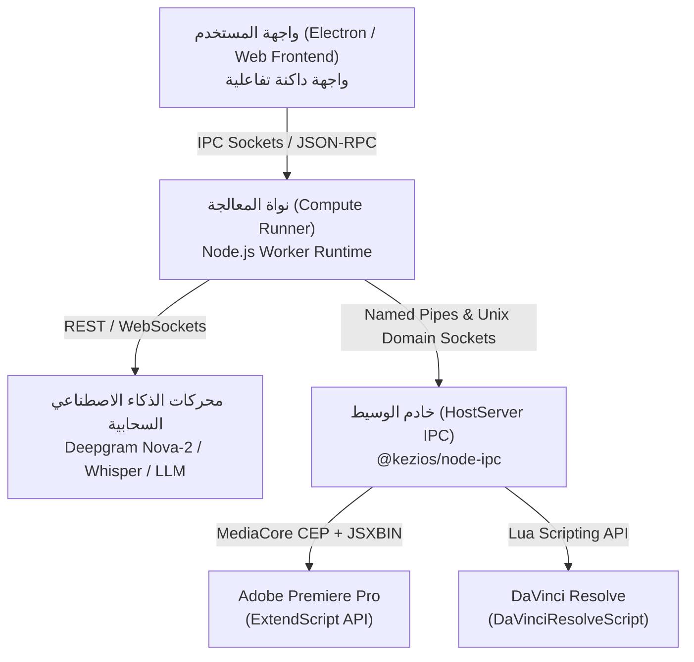

# الهندسة المعمارية والتحليل الشامل لأدوات AutoCut (v4.60.33)
> دراسة بحثية مبنية على الهندسة العكسية لنواة الحوسبة (`com.autocut.compute`)، وخدمة الاتصال الداخلي (`hostServer`)، ونموذج الحالة التراكمية (`autocut.state.json`).

---

## 1. المعمارية العامة للنظام (System Architecture)

تعتمد بنية **AutoCut** على نموذج موزّع رباعي الطبقات (Quad-Layer Decoupled Architecture):

---

## 2. تفكيك وبحث الميزات الـ 10 طبق الأصل (Feature Breakdown)

### 1. قص الصمت التلقائي (AutoCut Silences)
* **الهدف:** إزالة الوقفات الفارغة وفترات الصمت تلقائياً دون التأثير على إيقاع الحديث البشري.
* **الخوارزمية من الكود الأصلي:**
  * تحليل طاقة الإشارة الصوتية **RMS (Root Mean Square)** أو كشف النشاط الصوتي **VAD**.
  * **Noise Threshold:** عتبة الضوضاء الافتراضية هي `-35 dB`.
  * **Min Time of Silence:** الحد الأدنى للصمت لاعتباره فترة قص = `0.3s` (300ms).
  * **Min Time of Talk:** الحد الأدنى للكلام لعدم قصه = `0.2s` (200ms).
  * **Padding Margins:** هوامش أمان قبل القطع وبعده لمنع بتر مخارج الحروف (`marginBefore: 0.2s`, `marginAfter: 0.2s`).
  * **Timeline Cuts:** إرسال أمر `batchCutAndDelete` لبريمير أو `cutBatch` مع حذف وتمويج المسارات (Ripple Delete).

---

### 2. الترجمات الحركية الذكية (AutoCaptions)
* **الهدف:** توليد نصوص متحركة جذابة على الفيديو كلمة بكلمة (Kinetic Typography) تزيد من تفاعل المشاهدين على منصات TikTok/Reels/Shorts.
* **الخوارزمية والمعايير المستخرجة:**
  * تفريغ صوتي بنموذج `Deepgram Nova-2` أو `Whisper` لاستخراج الكلمات مع طوابع زمنية دقيقة بالمللي ثانية (`start_ms`, `end_ms`).
  * **تلوين الكلمة المنطوقة:** الكلمة الحالية يتم إحاطتها بمستطيل برتقالي مستدير الحواف بلون `rgb(230, 80, 25)` مع خط بلون أبيض `rgb(255, 255, 255)`.
  * **تخطيط الخط والحدود:** حجم الخط الافتراضي `100pt`، خط ArialMT، حدود سوداء خارجية `outline width: 8px`.
  * **الموقع:** مركز الشاشة الأفقي `xPercentage: 0.5`، والثلث السفلي رأسياً `yPercentage: 0.75`.
  * **التكامل:** إنشاء مسار ترجمة إما عبر `Fusion Text+` في DaVinci Resolve أو طبقة MOGRT / Graphics في Premiere Pro.

---

### 3. التقريب والتبعيد الديناميكي (AutoZoom)
* **الهدف:** كسر رتابة اللقطات الثابتة عبر عمل زوم تلقائي احترافي (Punch-in / Zoom-in) على المتحدث.
* **المعايير المحددة في ملف الحالة:**
  * `triggers: ["silence"]` (يتم تشغيل الزوم تلقائياً عند الانتقال بين الجمل أو بعد الوقفات).
  * `maxZoomPercentage: 1.3` (تكبير بنسبة 130% من الحجم الطبيعي).
  * `rythmPercentage: 0.6` (إيقاع تقريب متوازن مع مدة الجملة).
  * `zoomTypes: ["progressive", "fastProgressive", "instant"]`.
  * يتم تطبيق التحريك عبر دالة `applyMotionAnimationBatch` التي تعدل خواص `scale` و `anchor_point` لضمان بقاء وجه المتحدث في مركز الإطار.

---

### 4. فلتر الكلمات النابية والرقابة (AutoProfanity Filter)
* **الهدف:** اكتشاف الشتائم أو الكلمات غير اللائقة وحجبها بصوت صفير (Bleep Tone 1000Hz) أو كتمها على المسار الصوتي، مع تعتيم أو استبدال النص بـ `*BIIIP*` أو `*#$@!*`.
* **الآلية:**
  * مطابقة النص المستخرج من الصوت مع معجم الكلمات المحظورة `swearWordsDictionary`.
  * استبدال فترة الكلمة المحددة بموجة جيبية بتردد `1000 Hz` (أو خفض الصوت تماماً لـ `-100dB`).
  * تلوين فترات الحجب على التايملاين باللون الأحمر مع إضافة علامات الرقابة.

---

### 5. تحليل زوايا الكاميرا (AutoCut Angles)
* **الهدف:** التبديل الآلي بين زوايا التصوير المتعددة بناءً على تعابير الوجه والتوقفات والانتقالات الدلالية.
* **المعايير:**
  * `minimumCamTime: 10s` (منع التقطيع السريع المشتت للعين).
  * `triggers: { silence: true, cuts: true, emotion: true, transcript: true }`.
  * استخدام تسلسل Multi-Camera Clip وتبديل الزاوية النشطة دون إعادة تقطيع الملف الخام.

---

### 6. مونتاج البودكاست والكاميرات المتعددة (AutoCut Podcast)
* **الهدف:** معالجة حوارات المقابلات الصوتية والمرئية وتحديد من يتحدث بين المضيف والضيف.
* **الآلية:**
  * مقارنة مصفوفات طاقة الصوت (RMS Energy Matrix) عبر المسارات الصوتية المنفصلة (Track 1 للمضيف مقابل Track 2 للضيف).
  * احتساب نسبة العزل ومنع التداخل الصوتي (Bleed Crosstalk).
  * تفعيل لقطات ردود الفعل `enableReactionShots: true` بنسب زمنية محددة (`maximumCamTime: 3s`).

---

### 7. التكرارات واللقطات الفاشلة (AutoCut Repeat)
* **الهدف:** حذف العثرات والتكرارات وإعادة المحاولات (False Starts / Stuttering) والإبقاء فقط على المحاولة السليمة الأخيرة.
* **الآلية:**
  * مقارنة سلاسل النصوص الدلالية عبر نماذج Levenshtein Distance وتحديد العبارات المتشابهة المتعاقبة (مثل: `"What is the..."` -> `"AutoCut is extension..."` -> `"AutoCut is the best extension"`).
  * وسم المحاولات الأولى باللون الأحمر وحذفها، مع إبقاء الجملة الأخيرة مكتملة المعنى موسومة باللون الأخضر.

---

### 8. الفصول التلقائية (AutoChapters)
* **الهدف:** تقسيم الفيديوهات الطويلة وحلقات البودكاست إلى فصول ومحاور زمنية جاهزة لليوتيوب.
* **الآلية:**
  * رصد فترات الصمت الممتدة والتحولات الموضوعية في النص.
  * توليد علامات زمنية (Markers) ملونة (`color: Green`) وتسميتها تلقائياً `CHAPTER 1`, `CHAPTER 2`...
  * تصدير ملف نصي جاهز بتوقيتات يوتيوب `exportChaptersToTxt: true`.

---

### 9. المشاهد التوضيحية (AutoB-Rolls)
* **الهدف:** إضافة مقاطع فيديو وصور أرشيفية أو توضيحية فوق صوت المتحدث تلقائياً.
* **الآلية:**
  * تحليل محتوى النص واستخراج الكلمات المفتاحية التوضيحية.
  * وضع كتل المشاهد البديلة على مسار الفيديو العلوي (Track V2) مع الحفاظ على المسار الصوتي الأصلي دون انقطاع.

---

### 10. استخراج المقاطع الفيروسية (AutoViral)
* **الهدف:** تحويل الفيديوهات الأفقية (16:9) إلى مقاطع رأسية (9:16) جاهزة للنشر على تيك توك وريلز مع استخراج المقاطع الأكثر جذباً.
* **الآلية:**
  * تقييم المقاطع وفق معايير الانتشار: قوة البداية (Hook Score)، إمكانية إثارة الجدل (Debate Potential)، وعمق الفكرة.
  * تحديد مدة المقاطع بين `60s` إلى `90s`.
  * تطبيق إعادة التأطير التلقائي `autoReframePreset` لتركيز الوجه في منتصف الإطار الرأسي.
