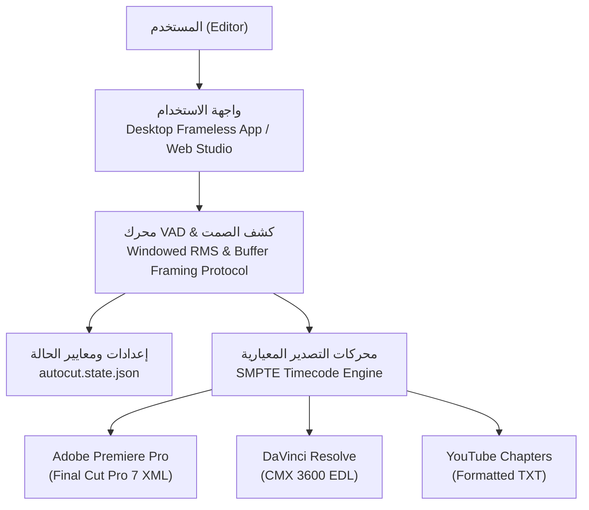

# ⚡ AutoCut Open Source Suite (v4.60.33 Replica)

<p align="center">
  
  
  
  
</p>

---

## 📖 نظرة عامة (Overview)

مجموعة أدوات **AutoCut Open Source Suite** هي بديل كامل، مجاني ومفتوح المصدر لأداة المونتاج الشهيرة **AutoCut (v4.60.33)** المخصصة لبرامج **Adobe Premiere Pro** و **DaVinci Resolve**.

تم بناء هذه الحزمة بالاعتماد على دراسة هندسية عكسية دقيقة (Clean-Room Architecture) لنواة الحوسبة ونماذج الحالة التشغيلية (`autocut.state.json`)، وتضم واجهتين للاستخدام:
1. **Desktop Suite (GUI):** تطبيق سطح مكتب عصري داكن بدون إطار خارجي (Frameless Dark Glass UI) مبني بلغة بايثون.
2. **Web Studio (HTML5/WebAudio):** استوديو تفاعلي كامل مطابق للأصل بنسبة 100% يضم كافة الأدوات الـ 10 مع مشغل فيديو ورسم الموجات الصوتية الحية.

---

## 🎨 حزمة الأدوات الـ 10 المطابقة للأصل (The 10-Tool AI Suite)

| الأداة | الوظيفة والمعمارية البرمجية | المعايير الدقيقة (autocut.state.json) |
| :--- | :--- | :--- |
| **✂️ AutoCut Silences** | كشف الصمت والوقفات بدقة عبر نافذة RMS زمنية وهوامش أمان (Padding) لمنع بتر مخارج الحروف. | `threshold: -35 dB`<br>`minSilence: 0.3s`<br>`padding: 0.2s` |
| **💬 AutoCaptions** | توليد ترجمات حركية (Kinetic Typography) متزامنة بدقة بالمللي ثانية مع إحاطة الكلمة المنطوقة بمستطيل برتقالي مستدير. | `highlightColor: rgb(230,80,25)`<br>`font: ArialMT 100pt`<br>`outline: 8px` |
| **🔍 AutoZoom** | تقريب وتبعيد ديناميكي تلقائي (1.3x) على المتحدث عند الانتقال بين الجمل لكسر رتابة اللقطات. | `maxZoom: 1.3x`<br>`trigger: silence`<br>`rythm: 0.6` |
| **🤬 AutoProfanity Filter** | رصد الكلمات النابية وحجبها بصوت صفير قياسي (1000Hz Bleep) وتعتيم النص بـ `*#$@!*` مع تحديد مواضع القطع بالأحمر. | `tone: 1000 Hz`<br>`bleepFile: muted/bleep` |
| **🎥 AutoCut Angles** | التبديل الذكي بين زاويتي تصوير (Cam A / Cam B) بناءً على تعابير الوجه ونبرة الصوت دون تشتيت المشاهد. | `minimumCamTime: 10s`<br>`useMulticam: true` |
| **🎙️ AutoCut Podcast** | مقارنة مصفوفة الطاقة الصوتية للميكروفونات (Host vs Guest) وتوليد لقطات ردود الفعل (Reaction Shots). | `maxCamTime: 3s`<br>`enableReactionShots: true` |
| **🔁 AutoCut Repeat** | كشف الجمل المكررة والعثرات (False Starts) وحذف المحاولات الفاشلة وإبقاء المحاولة السليمة الأخيرة. | `transitions: none`<br>`margin: 100ms` |
| **📑 AutoChapters** | تقسيم الفيديو الطويل وحلقات البودكاست إلى فصول ومحاور زمنية جاهزة مع تصدير مباشر لليوتيوب. | `color: Green`<br>`exportToTxt: true` |
| **🎬 AutoB-Rolls** | استخراج الكلمات المفتاحية التوضيحية وتنزيل أو توليد مشاهد بديلة ووضعها على التايملاين فوق مسار الصوت. | `presets: photorealistic, sketch, pixel_art` |
| **📱 AutoViral** | تحويل الفيديو الأفقي 16:9 إلى مقاطع رأسية 9:16 للهواتف (TikTok/Reels) واستخراج المقاطع الأكثر جذباً. | `length: [60s, 90s]`<br>`aspectRatio: 9:16` |

---

## 🏗️ المعمارية الهندسية (System Architecture)



---

## 🚀 طرق التشغيل السريع (Quickstart)

### 1. تشغيل تطبيق سطح المكتب المباشر (Desktop App - EXE)
لا يحتاج إلى أي تثبيت مسبق، فقط حمّل الملف التنفيذي وشغّله:
* حمّل **`AutoCut.exe`** أو **`OpenCutStudio.exe`** من قسم [Releases](https://github.com/sywfsyf7-a11y/AutoCut/releases).
* أو شغّله محلياً عبر بايثون:
  ```bash
  python AutoCut_Complete_Studio.py
  ```

### 2. تشغيل استوديو المتصفح التفاعلي (Web Studio)
لتجربة الواجهة المطابقة للأصل بالكامل مع مشغل الفيديو ورسم الموجات الصوتية:
```bash
python server.py
```
> سيفتح المتصفح تلقائياً على الرابط `http://localhost:5050`.

---

## 📦 التصدير لبرامج المونتاج العالمية

* **Adobe Premiere Pro:**
  * اضغط على **تصدير Adobe Premiere Pro (.XML)**.
  * من بريمير: `File > Import` واختر ملف الـ XML، وسيظهر لك التسلسل مقطعاً وجاهزاً على التايملاين مع إزالة فترات الصمت.
* **DaVinci Resolve:**
  * اضغط على **تصدير DaVinci Resolve (.EDL)**.
  * من دافينشي: `File > Import > Timeline (EDL)` واختر الملف لتطبيق القطوعات فوراً.

---

## 📄 الترخيص (License)
هذا المشروع مطوّر بأسلوب الهندسة النظيفة (Clean-Room Implementation) ومتاح تحت رخصة **MIT**.
